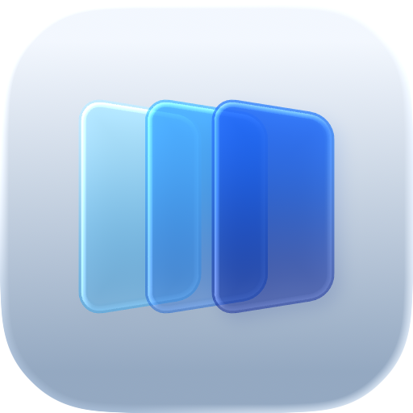

<p align="center">
  <picture>
    <source media="(prefers-color-scheme: dark)" srcset="docs/assets/defi-icon-dark.png">
    <source media="(prefers-color-scheme: light)" srcset="docs/assets/defi-icon-light.png">
    
  </picture>
</p>

<h1 align="center">Defi</h1>

<p align="center">A scrolling window manager for macOS.</p>

<p align="center">
  <a href="https://github.com/qeude/Defi/releases/latest"></a>
  
  
  <a href="LICENSE"></a>
</p>

<p align="center">
  <a href="#get-started">Get started</a> ·
  <a href="CONFIGURATION.md">Configuration</a> ·
  <a href="CONTRIBUTING.md">Contributing</a>
</p>

https://github.com/user-attachments/assets/1b1a4250-9940-42c3-b99b-614b77b053b7

Defi lays out your windows as columns on a strip that scrolls sideways. Each new
window adds a column, and focusing one off screen scrolls it into view. Clicks,
the Dock, and Command-Tab work as usual.

Inspired by [Niri](https://github.com/YaLTeR/niri), built for native macOS windows.
Defi is in alpha, so behavior and configuration may still change.

## Features

- **Scrolling columns**: automatic tiling, vertical stacks, adjustable widths.
- **Workspaces**: each display keeps its own, with an empty one always ready.
  The Overview shows them all.
- **Smooth motion**: windows glide on an overlay, then move once underneath.
- **App rules**: send apps to a workspace, float them, or set their width.
- **Keyboard and mouse**: custom shortcuts with a cheatsheet, and drag to reorder.
- **Scriptable**: live TOML config, a CLI, and a
  [SketchyBar integration](contrib/sketchybar/README.md).

Window borders, gaps, and every other option are in the
[configuration reference](CONFIGURATION.md).

## Get started

```sh
brew install --cask qeude/tap/defi
open /Applications/Defi.app
```

> [!NOTE]
> Defi is self-signed and not notarized, so only install it if you trust this
> source. Homebrew and the install script skip the quarantine check; the script
> verifies the release signature instead.

<details>
<summary>Other ways to install</summary>

**Install script**

```sh
curl -fsSL https://raw.githubusercontent.com/qeude/Defi/main/script/install.sh | sh
```

**DMG**: download it from the
[latest release](https://github.com/qeude/Defi/releases/latest) and drag Defi to
Applications. On first launch, close the warning, click **Open Anyway** in
System Settings › Privacy & Security, and confirm. Later updates skip this step.

**From source**: see [Build and run](CONTRIBUTING.md#build-and-run).

</details>

### Permissions

Defi asks for Accessibility on first launch and picks it up without a restart,
then asks for Screen Recording.

| Permission | Used to | Without it |
| --- | --- | --- |
| **Accessibility** (required) | Focus and arrange windows | Defi cannot manage windows |
| **Screen Recording** | Animate window pictures and show Overview previews | Windows move at once; Overview cards have no pictures |

Window pictures stay in memory and never leave your Mac. To start Defi with
macOS, turn on **Launch Defi at login** in Settings › General.

### Updates

Once a day, Defi checks GitHub for a new release. It is Defi's only network
request and sends nothing about you. New releases install from a small panel,
only if signed by the same release certificate, and keep your workspaces.

Turn the check off in Settings › General, or run it by hand from Settings ›
About or the menu bar. Builds not signed with the release certificate never
check. Homebrew users can keep using `brew upgrade --cask defi`.

## Keyboard shortcuts

Shortcuts use <kbd>⌃</kbd><kbd>⌥</kbd> (Control + Option), leaving Option free
for typing. Hold them to show the cheatsheet.

| Action | Shortcut |
| --- | --- |
| Focus a column | <kbd>⌃</kbd><kbd>⌥</kbd><kbd>←</kbd> <kbd>→</kbd> or <kbd>H</kbd> <kbd>L</kbd> |
| Focus a window in a stack | <kbd>⌃</kbd><kbd>⌥</kbd><kbd>↑</kbd> <kbd>↓</kbd> or <kbd>K</kbd> <kbd>J</kbd> |
| Switch workspace | <kbd>⌃</kbd><kbd>⌥</kbd><kbd>I</kbd> <kbd>U</kbd> or <kbd>1</kbd>…<kbd>9</kbd> |
| Move a column or window | <kbd>⌃</kbd><kbd>⌥</kbd><kbd>⌘</kbd> + arrow |
| Move a column to another workspace | <kbd>⌃</kbd><kbd>⌥</kbd><kbd>⌘</kbd><kbd>I</kbd> <kbd>U</kbd> |
| Join a window to the next stack, or take it out | <kbd>⌃</kbd><kbd>⌥</kbd><kbd>[</kbd> <kbd>]</kbd> |
| Cycle column width | <kbd>⌃</kbd><kbd>⌥</kbd><kbd>R</kbd>, or <kbd>−</kbd> <kbd>=</kbd> |
| Toggle full width | <kbd>⌃</kbd><kbd>⌥</kbd><kbd>F</kbd> |
| Open Overview | <kbd>⌃</kbd><kbd>⌥</kbd><kbd>O</kbd> |
| Focus another display | <kbd>⌃</kbd><kbd>⌥</kbd><kbd>⇧</kbd> + arrow |

Control + Option focuses, adding Command moves what is focused, and adding
Shift reaches other displays or reorders workspaces.

See [all built-in shortcuts](CONFIGURATION.md#built-in-defaults).

> [!TIP]
> Prefer one key? Remap Caps Lock to a Hyper key (⌃⌥⌘), then set
> [`mod`](CONFIGURATION.md#mod) to `"ctrl+alt+cmd"` in your config or in
> Settings › Input › Mod key.
> Hyper already holds Command, so the move shortcuts then need bindings of your
> own in `[keys]`.

## Configuration

Defi works without a config file. Add overrides to `~/.config/defi/config.toml`;
changes reload on save and updates never touch it. Start from the
[configuration reference](CONFIGURATION.md), or borrow from the
[maintainer's setup](config.example.toml).

<details>
<summary>Command line</summary>

The `defi` CLI ships inside the app:

```sh
/Applications/Defi.app/Contents/MacOS/defi status
/Applications/Defi.app/Contents/MacOS/defi focus-column right
/Applications/Defi.app/Contents/MacOS/defi workspace dev  # needs a workspace named dev
```

Source builds, and installs where `/Applications` is not writable, use
`~/Applications` instead. See the
[command reference](CONFIGURATION.md#commands).

</details>

<details>
<summary>Uninstall</summary>

With Homebrew, `brew uninstall --cask --zap defi` also removes your config and
saved state. Otherwise, run the CLI of the app to remove:

```sh
/Applications/Defi.app/Contents/MacOS/defi uninstall --purge
```

This removes that app, plus Defi's config, saved state, logs, login item, and
privacy permissions. Other Defi app bundles stay but lose that shared data.

</details>

## Troubleshooting

<details>
<summary>Shortcuts do nothing</summary>

1. Check that the installed Defi app has Accessibility permission.
2. With a Hyper `mod`, make sure your keyboard remap sends the same keys.
3. Quit other window managers to rule out conflicting shortcuts.

</details>

<details>
<summary>An app does not tile well</summary>

Some apps limit their window size or support Accessibility poorly. Defi also
manages its own virtual workspaces, not native macOS Spaces.
[Open an issue](https://github.com/qeude/Defi/issues/new/choose) with the app name
and what you expected.

</details>

<details>
<summary>How do I quit Defi without the menu bar?</summary>

Run `/Applications/Defi.app/Contents/MacOS/defi quit`, or quit `defi-daemon` in
Activity Monitor.

</details>

<details>
<summary>How do I report a bug?</summary>

Run `defi triage`, or choose **Start Triage** in Settings › General ›
Diagnostics. It collects your machine facts, then starts your own `claude` or
`codex` to investigate and draft the issue with you. It asks before it fixes or
posts anything. Without an agent, it prints a prompt you can paste into any
coding agent.

To report by hand, include your Defi and macOS versions, the affected apps, your
monitor setup, and steps to reproduce. `defi status` and `defi trace` help.
Their output can show window titles, paths, and workspace names, so share only
the relevant parts, redacted.

</details>

## Contribute

Bug reports and focused pull requests are welcome. See
[Contributing](CONTRIBUTING.md) or
[open an issue](https://github.com/qeude/Defi/issues/new/choose).

[MIT License](LICENSE)
