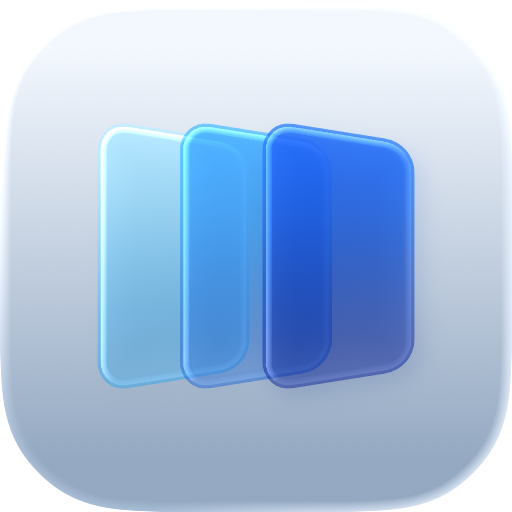

<p align="center">
  <picture>
    <source media="(prefers-color-scheme: dark)" srcset="docs/assets/defi-icon-dark.png">
    <source media="(prefers-color-scheme: light)" srcset="docs/assets/defi-icon-light.png">
    
  </picture>
</p>

<h1 align="center">Defi</h1>

<p align="center">A scrolling window manager for macOS.</p>

<p align="center">
macOS 26+ · Alpha
</p>

<p align="center">
  <a href="#get-started">Get started</a> ·
  <a href="CONFIGURATION.md">Configuration</a> ·
  <a href="CONTRIBUTING.md">Contributing</a>
</p>

https://github.com/user-attachments/assets/1b1a4250-9940-42c3-b99b-614b77b053b7

Defi arranges your windows in columns on a horizontal strip. Open another
window and the strip grows. Move to a window beyond the edge of your screen
and the desktop scrolls to bring it into view.

Inspired by [Niri](https://github.com/YaLTeR/niri), built for native macOS
windows. Click a window, select it in the Dock, or use Command-Tab as usual.

## Features

- **Automatic tiling**: Open a window and Defi places it in the layout. Close
  one and the remaining windows reflow automatically.
- **Scrolling columns**: Arrange windows on a
  horizontal strip, stack them vertically, and adjust column widths.
- **Dynamic workspaces**: Always have an empty
  workspace ready, and keep named workspaces for recurring tasks.
- **App rules & floating windows**: Send apps to named workspaces, keep them
  floating, or set their initial width. Float any other window with a shortcut.
- **Independent monitors**: Each display has its own workspaces and layout.
- **Overview**: Browse workspaces, select windows,
  and drag them between workspaces, with optional window previews.
- **Window borders**: Highlight the focused
  window, with configurable colors, width, and optional inactive borders.
- **Keyboard controls & cheatsheet**: Customize shortcuts and hold your
  modifier key to see available commands.
- **Mouse reordering**: Rearrange tiled
  windows by dragging them.
- **Native macOS interaction**: Keep using window clicks, the Dock, and
  Command-Tab.
- **Live configuration**: Customize gaps,
  animations, shortcuts, and rules in TOML; changes reload automatically.
- **CLI & SketchyBar integration**: Control Defi from scripts
  and expose workspace state in your bar.

[Configuration and commands](CONFIGURATION.md) ·
[SketchyBar integration](contrib/sketchybar/README.md)

## Get started

Defi supports **Apple Silicon Macs running macOS 26 or newer**.
Install with Homebrew:

```sh
brew install --cask qeude/tap/defi
open /Applications/Defi.app
```

Or without Homebrew:

```sh
curl -fsSL https://raw.githubusercontent.com/qeude/Defi/main/script/install.sh | sh
```

The app is signed with a self-signed certificate and is not notarized. Both
commands avoid macOS's block on unnotarized downloads, so only install if you
trust this source: the Cask removes the quarantine attribute, `curl` never adds
it, and the script checks the release signature.

You can also download the DMG from the
[latest release](https://github.com/qeude/Defi/releases/latest) and drag Defi to
Applications. macOS blocks its first launch: open Defi, close the warning, click
**Open Anyway** in System Settings › Privacy & Security, and confirm. Updates
then install without this step.

You can also [build from source](CONTRIBUTING.md#build-and-run).

The alpha is experimental. Behavior and configuration may change before the
first stable release.

On first launch, Defi requests **Accessibility** access. Grant it in System
Settings; Defi starts managing windows automatically, without a restart.
Defi needs this permission to focus and arrange windows.

Defi then requests **Screen Recording**. Many apps apply a window move late, so
moving real windows frame by frame stutters. Defi instead takes a picture of
each window, animates the pictures on an overlay, and moves each real window
once underneath. The Overview shows the same pictures in its cards. These
pictures stay in memory on your Mac. Defi never writes them to disk and never
sends them anywhere. Defi's only network use is the update check described in
[Updates](#updates). Without Screen Recording,
windows move at once and the Overview shows cards without pictures. You can
check or change the permission in Defi Settings › General.

Enable **Launch at Login** in the menu bar if you want Defi to start with macOS.

## Keyboard controls

Built-in shortcuts use Control + Option, which leaves Option free for typing
and word-by-word text editing. Hold Control + Option on their own to show the
shortcut guide, or start with these:

| Action | Shortcut |
| --- | --- |
| Focus a column | Control + Option + ← / → |
| Switch workspace | Control + Option + ↑ / ↓ |
| Focus a window in a stack | Control + Option + J / K |
| Move a column left or right | Control + Option + Shift + ← / → |
| Move a column to another workspace | Control + Option + Shift + ↑ / ↓ |
| Cycle column width | Control + Option + − / = |
| Toggle full column width | Control + Option + F |
| Open Overview | Control + Option + O |

For a single-key modifier, map a key such as Caps Lock to a **Hyper key**
(Control + Option + Command) and set
[`default_key_modifier`](CONFIGURATION.md#default_key_modifier) to a matching
`hyper` alias.

## Configuration

Defi works without a config file. Add overrides to
`~/.config/defi/config.toml` for gaps, shortcuts, named workspaces, and app rules.

Existing config files are preserved when you rebuild or update Defi.
Defi creates the config directory if needed, but no config file.
Changes reload automatically when you save, including your first config. The
[example configuration](config.example.toml) is the maintainer's setup;
copy only the parts you want.

<details>
<summary>Command-line control</summary>

The CLI is bundled with the app. For a source installation:

```sh
~/Applications/Defi.app/Contents/MacOS/defi status
~/Applications/Defi.app/Contents/MacOS/defi focus-column right
~/Applications/Defi.app/Contents/MacOS/defi workspace dev
```

The last command requires a named workspace called `dev`.
Use `/Applications/Defi.app` instead if that is where you installed Defi.
See the [command reference](CONFIGURATION.md#commands) for the full list.

</details>

<details>
<summary>Uninstall completely</summary>

For a Homebrew installation, use `brew uninstall --cask --zap defi`.
This also removes your configuration and saved state.

For a manual or source installation, run the CLI from your installed app:

```sh
~/Applications/Defi.app/Contents/MacOS/defi uninstall --purge
```

Use `/Applications/Defi.app` instead for an app installed there.
This removes the app containing the invoked CLI, plus Defi's shared
configuration, saved workspace state, logs, login item, and privacy permissions.
Other Defi app bundles are preserved, but they share the removed user data.

</details>

## Troubleshooting

If shortcuts do not respond, check Accessibility permission for the installed
Defi app; newly granted access is detected automatically. Check
`default_key_modifier` in your config:
custom Hyper bindings require a matching keyboard remap. Temporarily quit
other window managers to rule out conflicting shortcuts or window moves.

To stop Defi, choose **Quit Defi** in the menu bar. If the menu is unavailable,
run `~/Applications/Defi.app/Contents/MacOS/defi quit`, or quit `defi-daemon`
through Activity Monitor. Adjust the app path for an installation in
`/Applications`.

For a bug report, include your Defi and macOS versions, affected apps, monitor
setup, and steps to reproduce. The bundled CLI's `status` and `trace` commands
can help explain what happened. Review their output, config snippets, and
recordings before posting: they may expose window titles, paths, workspace
names, or other private information. Share only the relevant, redacted parts.

### Alpha limitations

Defi manages its own virtual workspaces, not native macOS Spaces. Apps can
impose window size constraints or expose limited Accessibility support, so
please report app-specific behavior. Screen Recording is optional; without it,
animations and Overview window previews are off.

### Updates

Once a day, Defi asks GitHub for the latest release and sends nothing about you
or your windows. When a newer version exists, a small panel offers to install
it; Defi then downloads the release, accepts it only if it is signed by the same
release certificate, and restarts with your workspaces intact. Turn the check
off in Defi Settings › About, or run it by hand there or from the menu bar. Builds not signed with the
release certificate never check. Homebrew installations can keep using `brew upgrade --cask defi`.

## Contribute

Bug reports and focused pull requests are welcome.
See [Contributing](CONTRIBUTING.md) for setup and checks, or
[open an issue](https://github.com/qeude/Defi/issues/new/choose) to report a
problem or propose an improvement.

[MIT License](LICENSE)
